# Arma Reforger Manager

Um gerenciador de servidor para Arma Reforger construído com Electron.

An Arma Reforger server manager built with Electron.

---

## PT-BR

### Visão geral

É um aplicativo Electron sem servidor local: a interface (`setup.html` e `index.html`) fala com o processo principal (`main.js`) só por IPC, através do `preload.js`, e não abre nenhuma porta de rede.
A lógica fica em `backend/`: perfis (`profiles.js`), configurações (`settings.js`), dados da Workshop (`workshop.js`), consulta direta ao servidor (`a2s.js`), BattleMetrics (`battlemetrics.js`), RCON (`rcon.js` + `be-rcon.js`) e o terminal (`logger.js`). Em `shared/` ficam regras usadas pela interface e pelos testes: ordem de carregamento (`load-order.js`), comparação de versão do jogo (`game-version.js`) e mapas e missões (`scenarios.js`).
A tela inicial (`setup.html`) lista os perfis; o painel (`index.html`) edita o perfil escolhido.
Os perfis de servidor são salvos no diretório de dados do usuário do Windows (veja "Onde os arquivos são salvos").

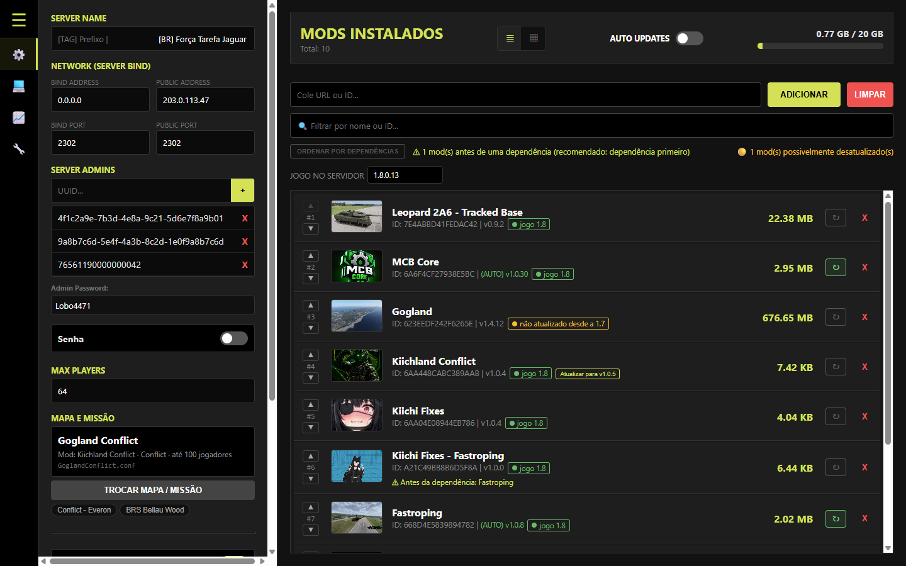

> As capturas usam dados de demonstração: nome do servidor, IP (faixa reservada para exemplos), jogadores, IDs e senhas são inventados. Os mods são reais, da Workshop (os mods Kiichi e as dependências deles).


### Funcionalidades

- Gerenciamento de perfis de servidor (`saves/*.json`)

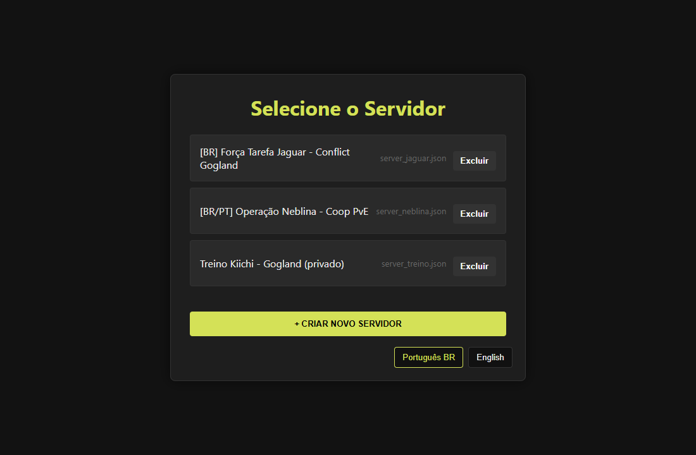

- Conexão via RCON (protocolo BattlEye RCon sobre UDP, o mesmo do servidor Arma Reforger)

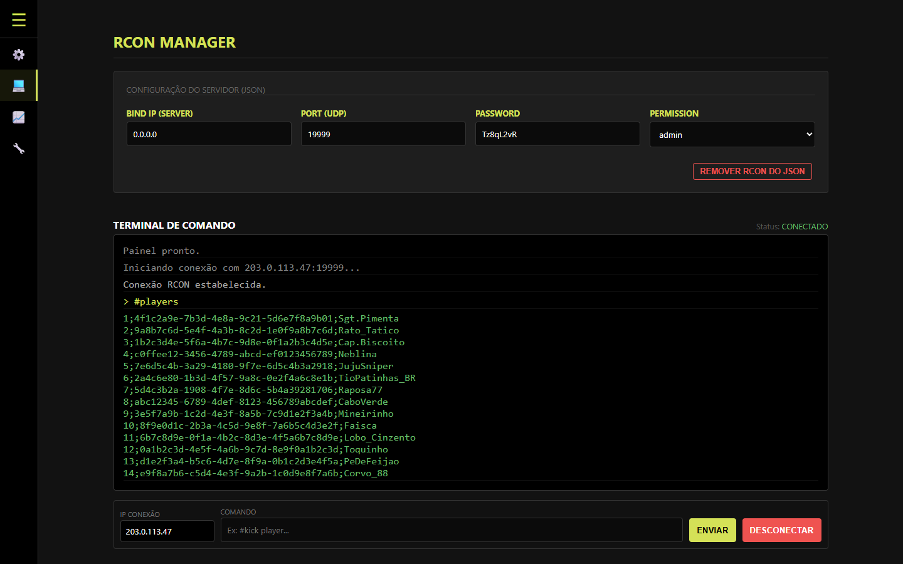

- Monitor do servidor sem depender de terceiros: status, jogadores, cenário, versão e ping consultados direto no servidor pelo protocolo A2S (Steam Query, porta do bloco `a2s` do config, padrão 17777/UDP). Os nomes dos jogadores vêm do RCON (`#players`), porque o A2S do Reforger não os informa. Rank e país continuam disponíveis pelo BattleMetrics, que exige um token de API (assinatura).

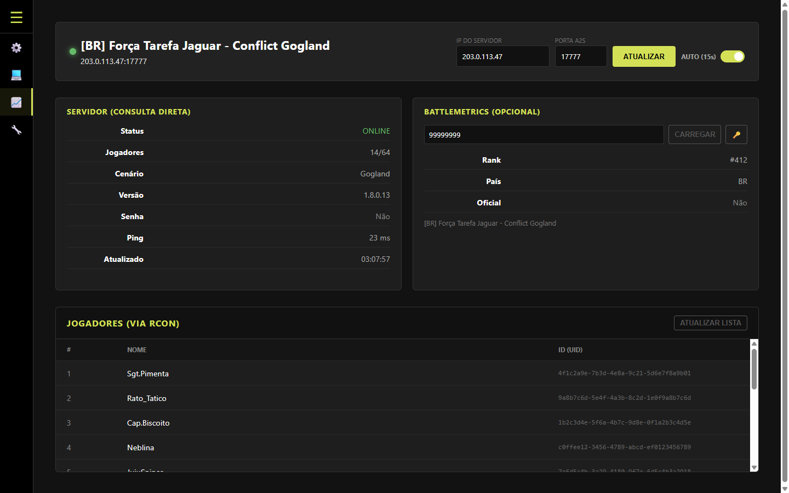

- Scraper de informações de mods da Workshop do Reforger

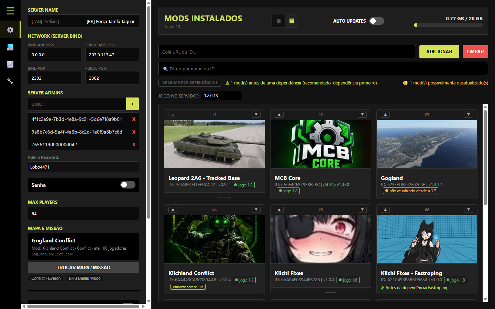

- Ordem de carregamento dos mods: a ordem da lista é a ordem gravada em `game.mods`. Dá para reordenar arrastando ou com os botões ▲ ▼ (também pelo teclado), cada mod mostra sua posição e o botão "Ordenar por dependências" coloca cada dependência antes do mod que a usa, mudando só o necessário. Dependências circulares geram aviso. "Instalar tudo" insere cada dependência logo antes do mod que precisa dela. A regra "dependência antes" vem de guias de hospedagem, não da documentação da Bohemia, por isso aparece como recomendação.

- Versão do jogo de cada mod comparada com a do servidor (só major.minor), usando a versão que o servidor vai baixar: a fixada no config ou a mais recente, se o auto update estiver ligado. 🔴 mod feito para um jogo mais novo que o servidor, 🟡 "não atualizado desde a X.Y" (aviso, não erro: muitos mods antigos funcionam), 🟢 mesma versão, cinza quando falta dado. Mods marcados como obsoletos na Workshop ganham um selo próprio e o topo da lista mostra o resumo. A versão do servidor vem do Monitor (A2S) e fica salva no perfil, ou pode ser digitada à mão. A página do mod só lista as últimas 10 versões; para versões fixadas mais antigas, o app consulta o changelog da Workshop e guarda em cache.

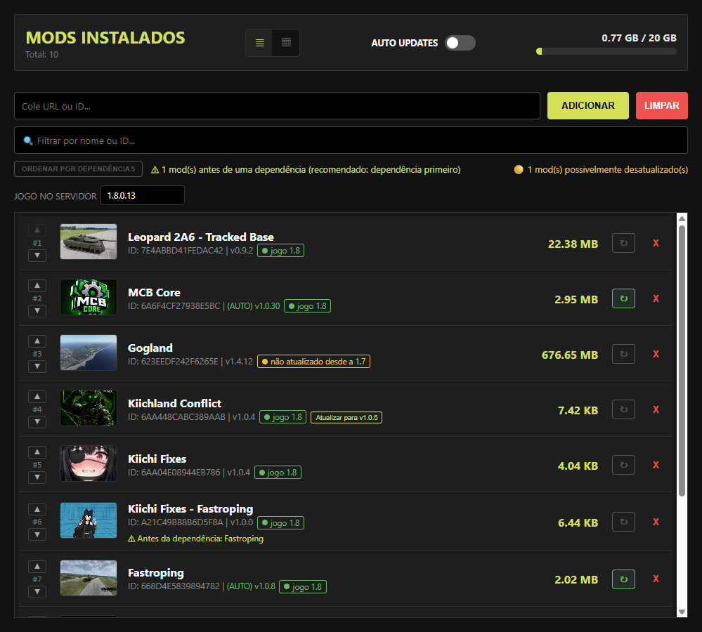

- Troca de mapas e missões: o cartão "Mapa e missão" mostra a missão atual com nome, mapa, modo e limite de jogadores, e o botão "Trocar mapa / missão" abre um seletor. Ele lista as 37 missões do jogo base por terreno (Everon, inclusive os Capture & Hold, Arland e Kolguyev) e, à parte, as de um jogador e de teste, as missões que os mods da lista publicam na Workshop e as de qualquer mod da Workshop, por URL ou ID, antes de adicioná-lo. Escolher a missão de um mod que não está na lista adiciona o mod e as dependências dele. Se o MAX PLAYERS passar do limite da missão, o app oferece ajustar. As últimas missões usadas ficam como atalhos, e as predefinições guardam missão e lista de mods juntas para trocar as duas de uma vez. O catálogo do jogo base foi extraído dos dados do jogo instalado: IDs, limite de jogadores, terreno (seguindo o mundo de cada missão até Everon, Arland ou Kolguyev) e nomes oficiais em português e inglês. A busca aceita nome, arquivo, mapa, modo ou mod, nas duas línguas. Trocar a missão muda o config; o servidor precisa ser reiniciado com o config novo.

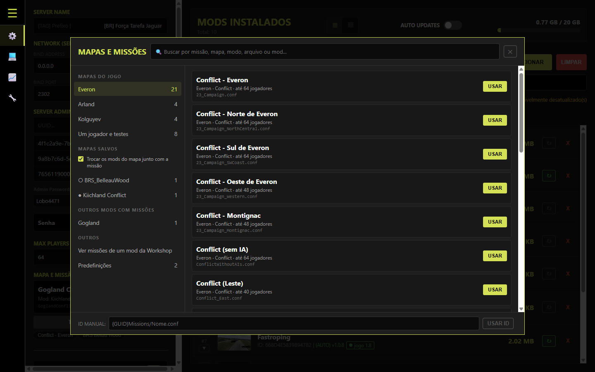

- Biblioteca de mapas: todo mapa de mod que você usa fica salvo no perfil com as dependências (e as versões) e as missões dele, mesmo depois de sair da lista. Com a opção "Trocar os mods do mapa junto com a missão" ligada (padrão), escolher a missão de outro mapa tira do config os mods do mapa anterior e coloca os do novo; escolher uma missão do jogo base tira os de todos os mapas. Nunca saem mods fora da biblioteca, mods marcados como "manter sempre" (ex.: um pacote de conteúdo usado por outros mods) nem mods de que outro mod da lista depende. O cartão mostra o que saiu e entrou, com "Desfazer".

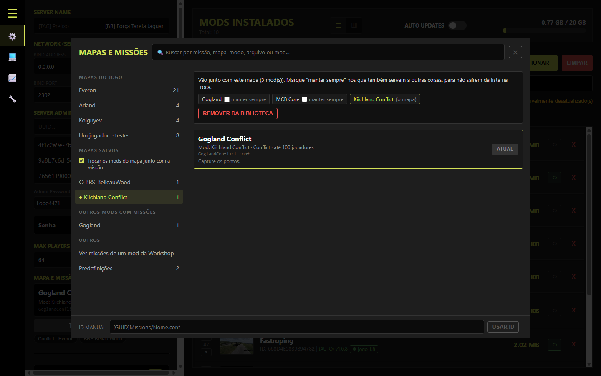

- Terminal ao vivo dividido (aba Outros): Principal (processo principal e interface), Backend (Workshop, RCON, A2S, BattleMetrics) e Erros (todo erro de qualquer origem), com contador de erros não lidos, filtro por módulo e botões copiar e limpar. Erros esperados (mod não encontrado, servidor sem resposta, token ausente) aparecem como aviso; exceções sem tratamento do processo principal e erros da interface também chegam ao terminal. A rolagem só acompanha as novas linhas quando você já está no fim. Mensagens repetidas (ex.: o Monitor consultando um servidor desligado a cada 15 s) aparecem uma vez a cada 5 minutos.

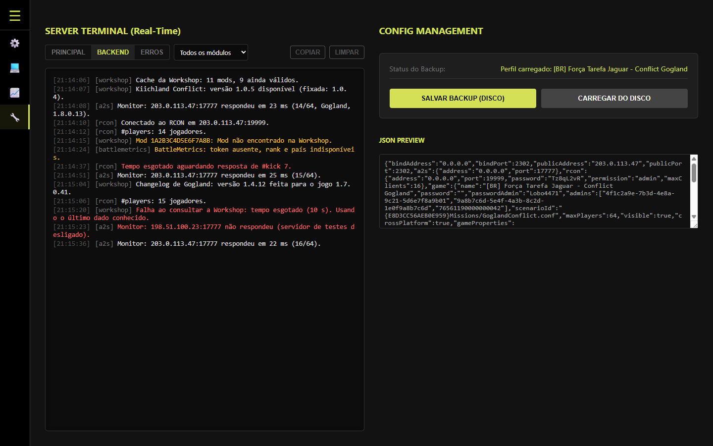

- Interface de criação/importação de servidor

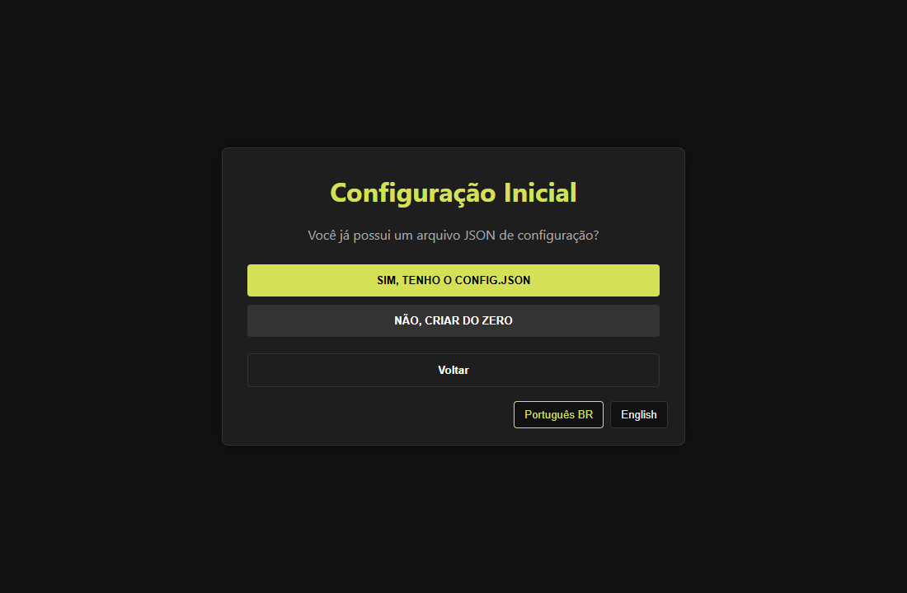
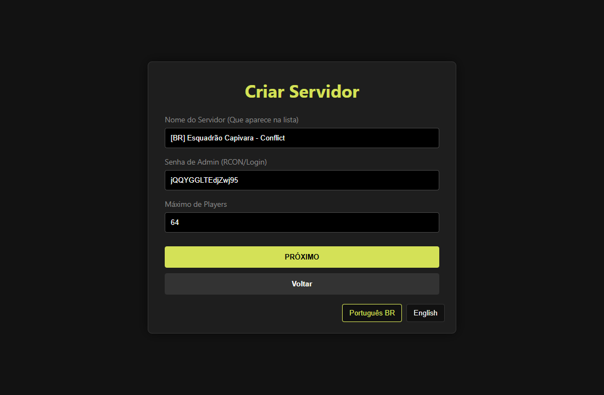


### Captura de Dados de Mods

O software utiliza web scraping para capturar informações de mods do marketplace da Bohemia Interactive (site oficial do Arma Reforger). Isso é feito porque a empresa não fornece uma API oficial para busca e consulta de mods, forçando desenvolvedores a recorrer a métodos menos eficientes e mais propensos a falhas.

Os dados capturados incluem nomes, descrições, IDs e outras metadatas dos mods disponíveis na Workshop. Esses dados são utilizados para permitir que os usuários pesquisem, visualizem e adicionem mods aos seus perfis de servidor diretamente na interface do aplicativo, facilitando a configuração de servidores personalizados.

Infelizmente, a ausência de uma API dedicada torna o processo mais frágil, já que mudanças no layout do site podem quebrar a funcionalidade. Esperamos que a Bohemia Interactive considere implementar uma API oficial em futuras atualizações.

Para reduzir essa fragilidade, o app lê os dados estruturados que a própria página publica (`<script id="__NEXT_DATA__">`) em vez de procurar texto no HTML, consulta no máximo 4 mods ao mesmo tempo e guarda os resultados em cache (`mod-cache.json`) por 6 horas. O cache tem um número de esquema: quando os campos guardados mudam, um cache antigo é descartado e baixado de novo. A página passa pelo CDN da Workshop, que pode seguir entregando a cópia de antes de uma publicação por mais de uma hora; por isso cada consulta leva um parâmetro a mais na URL que pula esse CDN. Quando a versão fixada no config é mais nova do que a "mais recente" guardada (cache de antes da publicação), o app consulta de novo sem cache, e o mesmo vale para o mod que vai ser fixado ao entrar na lista ou ao desligar o auto update. O botão "Atualizar para" só aparece para uma versão mais nova; se a versão fixada não existe na Workshop, ele vira "Trocar para".

### Requisitos

- Node.js 22.12 ou superior (exigido pelo Electron 44)
- npm instalado
- Windows (recomendado para empacotamento com Electron)

### Instalação

1. Abra o terminal na pasta do projeto.
2. Execute:

```powershell
npm install
```

### Execução em modo de desenvolvimento

Execute:

```powershell
npm start
```

Ou use o atalho automático:

```powershell
start.bat
```

O `start.bat` verifica se `node_modules` existe, instala as dependências quando necessário, baixa o Electron na primeira vez (com o progresso visível) e inicia o aplicativo.

Isso iniciará o Electron que, por sua vez, carrega o backend local e abre a interface em uma janela.

### Compilação / Build

Para gerar o instalador do Windows, use:

```powershell
npm run dist
```

O pacote será criado na pasta `dist/`.

> Observação: o Windows Defender/SmartScreen pode bloquear o instalador em builds não assinados. Rode como administrador ou adicione exceção se necessário.

### Testes

```powershell
npm test
```

### Onde os arquivos são salvos

- Rodando pelo Electron (`npm start`): `%APPDATA%\compilador\saves`
- Build empacotado: `%APPDATA%\Arma Reforger Manager\saves`

Na mesma pasta-mãe ficam `settings.json` (token do BattleMetrics) e `mod-cache.json` (cache da Workshop).

### Problemas comuns

- Se o PowerShell bloquear o `npm`, habilite scripts locais:

```powershell
Set-ExecutionPolicy -ExecutionPolicy RemoteSigned -Scope CurrentUser
```

- Se o RCON não conectar:
  - Verifique host, porta e senha.
  - Confirme que o servidor Arma Reforger está com RCON habilitado.
  - A porta do RCON é UDP: libere-a no firewall do servidor.

---

## EN

### Overview

It is an Electron app with no local server: the UI (`setup.html` and `index.html`) talks to the main process (`main.js`) only over IPC, through `preload.js`, and no network port is opened.
The logic lives in `backend/`: profiles (`profiles.js`), settings (`settings.js`), Workshop data (`workshop.js`), direct server query (`a2s.js`), BattleMetrics (`battlemetrics.js`), RCON (`rcon.js` + `be-rcon.js`) and the terminal (`logger.js`). `shared/` holds rules used by both the UI and the tests: load order (`load-order.js`), game version comparison (`game-version.js`) and maps and missions (`scenarios.js`).
The start screen (`setup.html`) lists the profiles; the panel (`index.html`) edits the selected one.
Server profiles are saved in the user's Windows data directory (see "Where files are saved").

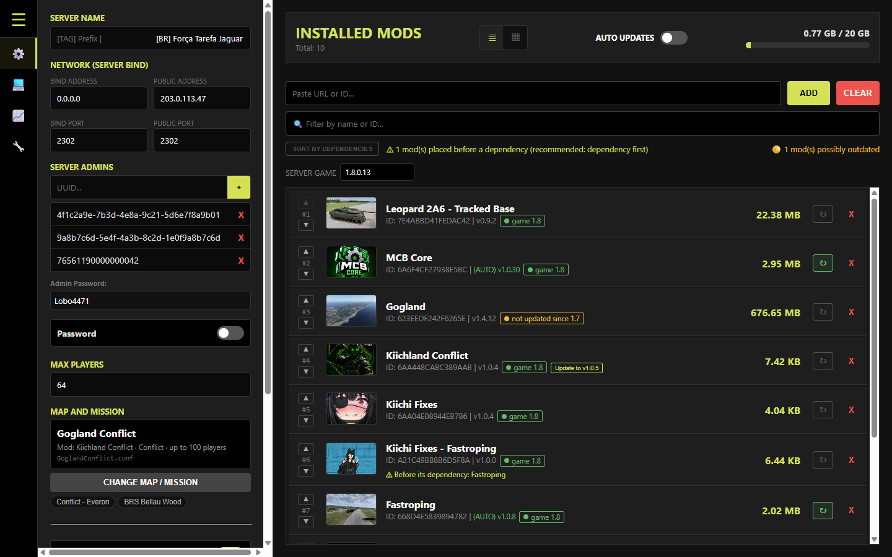

> The screenshots use demo data: server name, IP (a range reserved for documentation), players, IDs and passwords are made up. The mods are real Workshop mods (the Kiichi mods and their dependencies).

### Features

- Server profile management (`saves/*.json`)

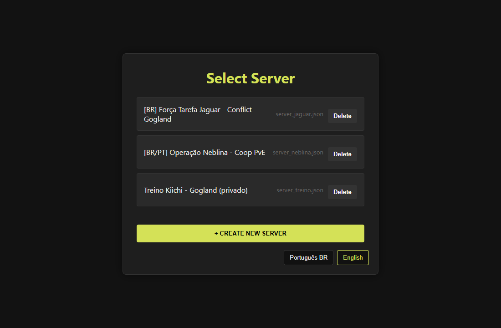

- RCON connection (BattlEye RCon protocol over UDP, the same one the Arma Reforger server uses)

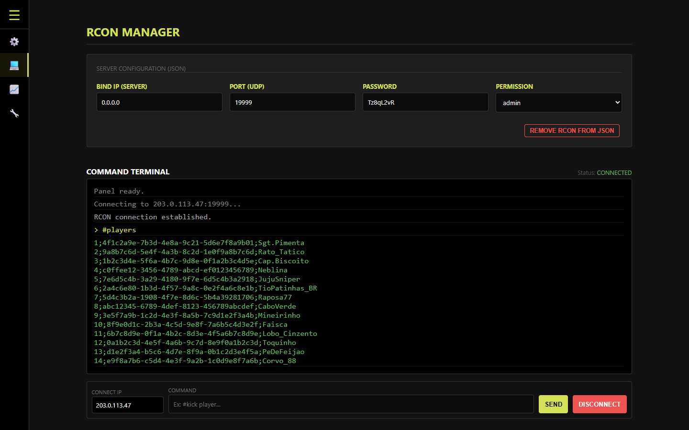

- Server monitor with no third party: status, players, scenario, version and ping queried straight from the server over A2S (Steam Query, the port of the config's `a2s` block, 17777/UDP by default). Player names come from RCON (`#players`), because Reforger's A2S does not report them. Rank and country are still available from BattleMetrics, which requires an API token (subscription).

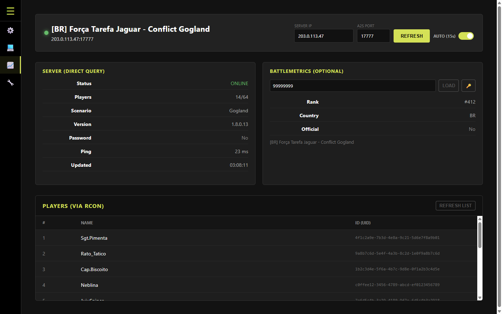

- Reforger Workshop mod scraping

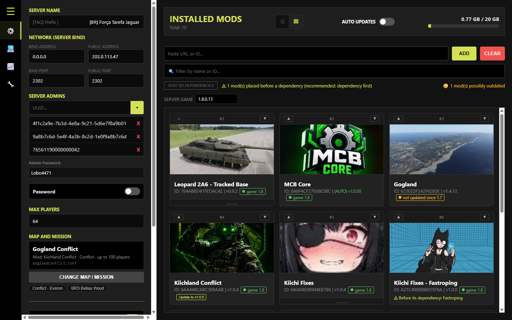

- Mod load order: the list order is the order written to `game.mods`. Reorder by dragging or with the ▲ ▼ buttons (keyboard too), each mod shows its position, and "Sort by dependencies" puts each dependency before the mod that uses it, moving only what is needed. Circular dependencies show a warning. "Install all" inserts each dependency right before the mod that needs it. The "dependency first" rule comes from hosting guides, not Bohemia's documentation, so it is shown as a recommendation.

- Game version of each mod compared with the server's (major.minor only), using the version the server will download: the one pinned in the config, or the latest when auto update is on. 🔴 the mod targets a newer game than the server, 🟡 "not updated since X.Y" (a warning, not an error: many old mods keep working), 🟢 same version, gray when data is missing. Mods marked obsolete on the Workshop get their own badge, and a summary sits on top of the list. The server version comes from the Monitor (A2S) and is saved in the profile, or can be typed by hand. A mod page only lists its last 10 versions; for older pinned versions the app reads the Workshop changelog and caches it.

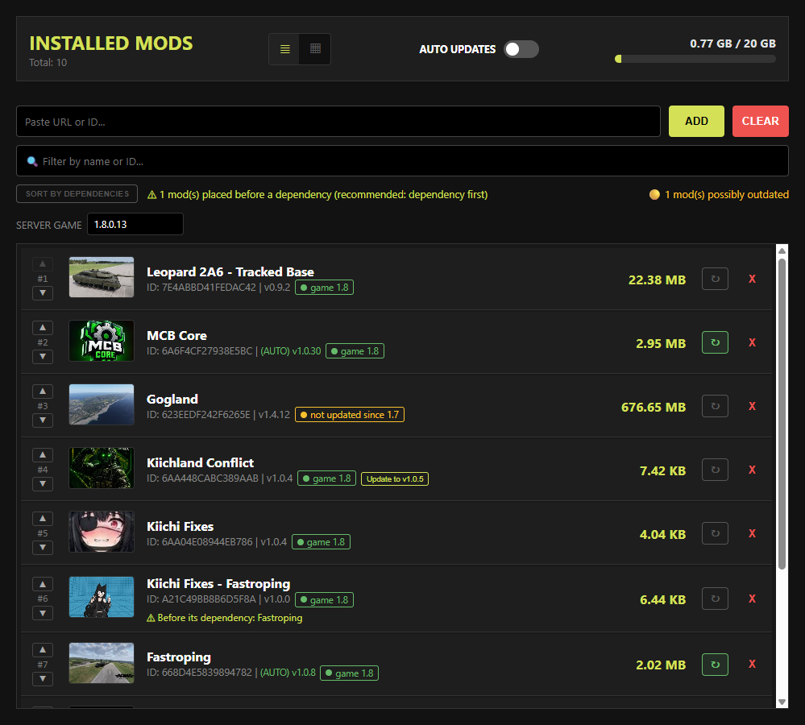

- Map and mission switching: the "Map and mission" card shows the current mission with its name, map, mode and player limit, and the "Change map / mission" button opens a picker. It lists the 37 base game missions by terrain (Everon, Capture & Hold included, Arland and Kolguyev) and, separately, the singleplayer and test ones, the missions the listed mods publish on the Workshop, and those of any Workshop mod, by URL or ID, before adding it. Choosing a mission from a mod that is not in the list adds the mod and its dependencies. If MAX PLAYERS is above the mission's limit, the app offers to adjust it. The last used missions stay as shortcuts, and presets store the mission and the mod list together to switch both at once. The base game catalog was extracted from the installed game data: IDs, player limit, terrain (following each mission's world up to Everon, Arland or Kolguyev) and official names in Portuguese and English. Search accepts name, file, map, mode or mod, in both languages. Changing the mission changes the config; the server must be restarted with the new config.

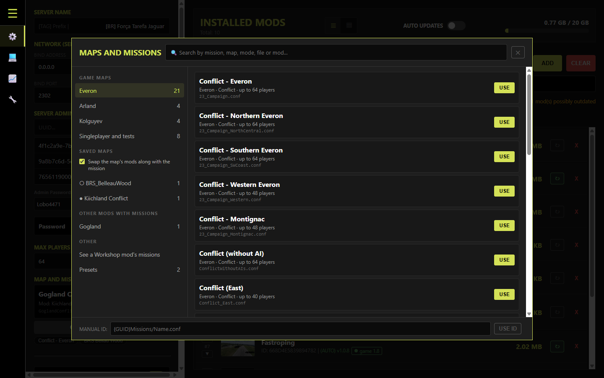

- Map library: every mod map you use is saved in the profile with its dependencies (and versions) and its missions, even after it leaves the list. With "Swap the map's mods along with the mission" on (default), choosing a mission from another map removes the previous map's mods from the config and adds the new map's; choosing a base game mission removes the mods of every map. Mods outside the library, mods marked "always keep" (e.g. a content pack used by other mods) and mods another listed mod depends on never leave. The card shows what left and came in, with "Undo".

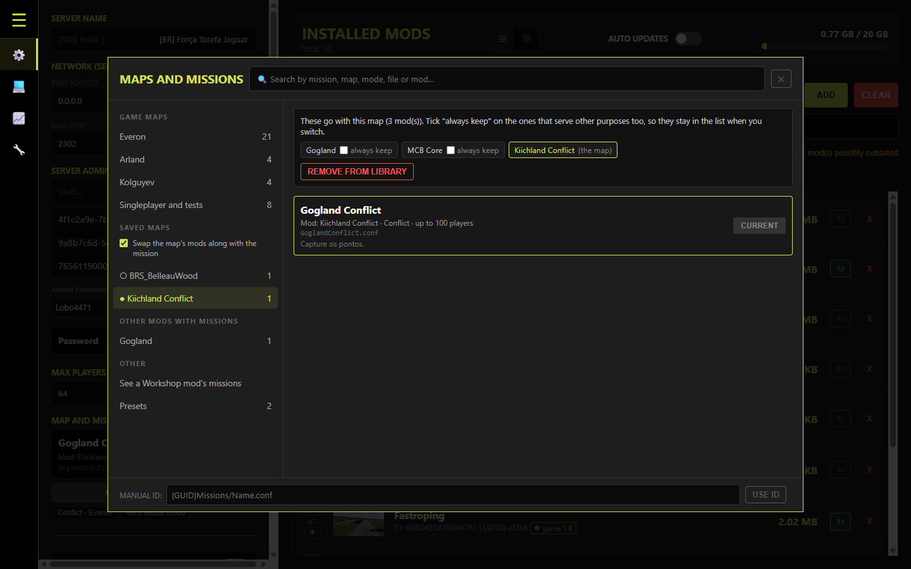

- Split live terminal (Others tab): Main (main process and UI), Backend (Workshop, RCON, A2S, BattleMetrics) and Errors (every error from any source), with an unread error counter, a module filter and copy and clear buttons. Expected errors (mod not found, server not answering, missing token) show as warnings; unhandled main-process exceptions and UI errors reach the terminal too. Scrolling only follows new lines when you are already at the bottom. Repeated messages (e.g. the Monitor polling a server that is down every 15 s) show once every 5 minutes.

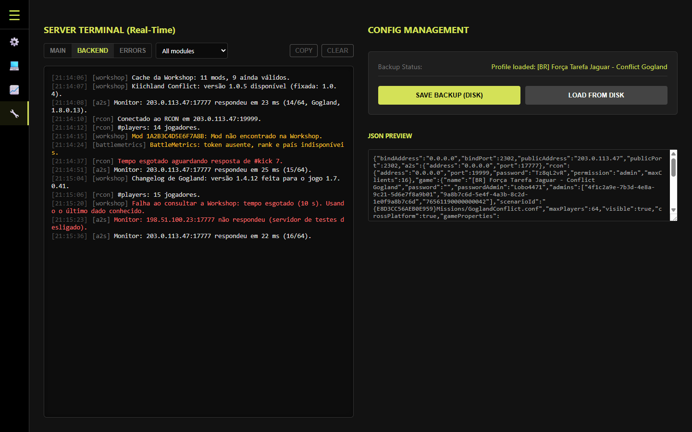

- Create/import server configuration

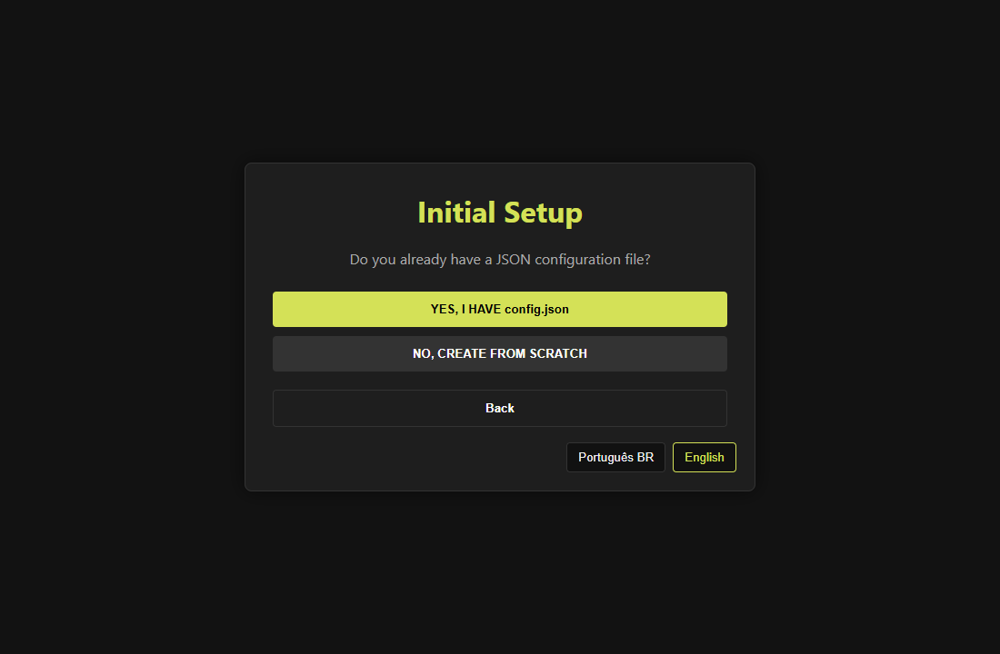
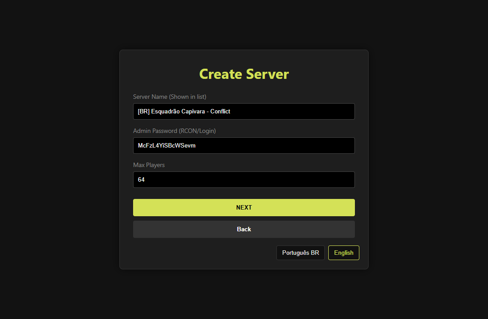


### Mod Data Capture

The software uses web scraping to capture mod information from Bohemia Interactive's marketplace (the official Arma Reforger website). This is necessary because the company does not provide an official API for searching and querying mods, forcing developers to use less efficient and more error-prone methods.

The captured data includes mod names, descriptions, IDs, and other metadata from available Workshop mods. This data is used to allow users to search, view, and add mods to their server profiles directly in the app's interface, making it easier to configure custom servers.

Unfortunately, the lack of a dedicated API makes the process more fragile, as changes to the website's layout can break functionality. We hope Bohemia Interactive will consider implementing an official API in future updates.

To reduce that fragility, the app reads the structured data the page itself publishes (`<script id="__NEXT_DATA__">`) instead of searching the HTML text, queries at most 4 mods at a time and caches the results (`mod-cache.json`) for 6 hours. The cache carries a schema number: when the stored fields change, an old cache is discarded and fetched again. The page goes through the Workshop CDN, which can keep serving the copy from before a release for more than an hour, so every request carries an extra URL parameter that skips that CDN. When the version pinned in the config is newer than the stored "latest" (a cache from before the release), the app fetches again without cache, and so does a mod that is about to be pinned (added to the list, or auto update turned off). The "Update to" button only shows for a newer version; when the pinned version does not exist on the Workshop it becomes "Switch to".

### Requirements

- Node.js 22.12 or newer (required by Electron 44)
- npm installed
- Windows recommended for Electron packaging

### Installation

1. Open a terminal in the project folder.
2. Run:

```powershell
npm install
```

### Run in development mode

Run:

```powershell
npm start
```

Or use the automatic launcher:

```powershell
start.bat
```

The `start.bat` checks for `node_modules`, installs dependencies if needed, downloads Electron on the first run (with visible progress) and starts the app.

This will launch Electron, which starts the backend and opens the UI in a window.

### Build / Packaging

To generate the Windows installer, run:

```powershell
npm run dist
```

The package will be created under `dist/`.

> Note: Windows Defender / SmartScreen may block unsigned installer builds. Run as administrator or add an exception if necessary.

### Tests

```powershell
npm test
```

### Where files are saved

- Running through Electron (`npm start`): `%APPDATA%\compilador\saves`
- Packaged app: `%APPDATA%\Arma Reforger Manager\saves`

The same parent folder holds `settings.json` (BattleMetrics token) and `mod-cache.json` (Workshop cache).

### Common issues

- If PowerShell blocks `npm`, allow local script execution:

```powershell
Set-ExecutionPolicy -ExecutionPolicy RemoteSigned -Scope CurrentUser
```

- If RCON fails to connect:
  - Check host, port and password.
  - Verify that the Arma Reforger server has RCON enabled.
  - The RCON port is UDP: open it in the server's firewall.
